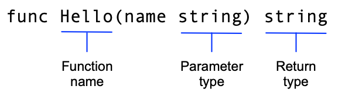

# Tutorial: Crie um module Go

> Tradução não oficial de [go.dev/doc/tutorial/create-module](https://go.dev/doc/tutorial/create-module).

Esta é a primeira parte de um tutorial que apresenta alguns recursos fundamentais da linguagem Go. Se você está começando agora com Go, dê uma olhada no [Tutorial: Primeiros passos com Go](getting-started.md), que apresenta o comando `go`, os Go modules e um código Go bem simples.

Neste tutorial, você vai criar dois modules. O primeiro é uma biblioteca (library), feita para ser importada por outras bibliotecas ou aplicações. O segundo é uma aplicação que chama (caller) o primeiro.

A sequência deste tutorial tem sete tópicos curtos, e cada um mostra uma parte diferente da linguagem.

1. Crie um module: escreva um module pequeno com funções que você pode chamar de outro module.
2. [Chame o seu código a partir de outro module](call-module-code.md): importe e use o seu novo module.
3. [Retorne e trate um erro](handle-errors.md): adicione um tratamento de erro simples.
4. [Retorne uma saudação aleatória](random-greeting.md): trabalhe com dados em slices (os arrays de tamanho dinâmico do Go).
5. [Retorne saudações para várias pessoas](greetings-multiple-people.md): guarde pares de chave/valor em um map.
6. [Adicione um teste](add-a-test.md): use os recursos de teste unitário embutidos no Go para testar o seu código.
7. [Compile e instale a aplicação](compile-install.md): compile e instale o seu código localmente.

> **Nota:** para outros tutoriais, veja o [índice de Tutoriais](README.md).

## Pré-requisitos

- **Um pouco de experiência com programação.** O código aqui é bem simples, mas ajuda saber algo sobre funções, loops e arrays.
- **Go.** Recomendamos usar a versão mais recente do Go para seguir este tutorial. Para instruções de instalação, veja [Installing Go](https://go.dev/doc/install).
- **Uma ferramenta para editar o código.** Qualquer editor de texto serve. A maioria tem bom suporte a Go. Os mais populares são VSCode (gratuito), GoLand (pago) e Vim (gratuito).
- **Um terminal de comandos.** O Go funciona bem em qualquer terminal no Linux e no Mac, e no PowerShell ou cmd no Windows.

## Comece um module que outras pessoas possam usar

Comece criando um Go module. Em um module, você reúne um ou mais packages relacionados, que formam um conjunto útil e bem definido de funções. Por exemplo, você pode criar um module com packages que tenham funções de análise financeira, para que outras pessoas que escrevem aplicações financeiras possam usar o seu trabalho. Para saber mais sobre como desenvolver modules, veja [Developing and publishing modules](https://go.dev/doc/modules/developing).

Código Go é agrupado em packages, e packages são agrupados em modules. O seu module especifica as dependências necessárias para rodar o código, incluindo a versão do Go e o conjunto de outros modules que ele exige.

À medida que você adiciona ou melhora funcionalidades no module, você publica novas versões dele. Quem escreve código que chama funções do seu module pode importar os packages atualizados e testar a nova versão antes de colocá-la em produção.

1. Abra um terminal e vá (`cd`) para a sua pasta pessoal (home).

   No Linux ou Mac:

   ```
   cd
   ```

   No Windows:

   ```
   cd %HOMEPATH%
   ```

2. Crie uma pasta `greetings` para o código-fonte do seu Go module.

   Por exemplo, a partir da sua pasta home, use os seguintes comandos:

   ```
   mkdir greetings
   cd greetings
   ```

3. Inicie o seu module usando o comando [`go mod init`](https://go.dev/ref/mod#go-mod-init).

   Rode o comando `go mod init` passando o module path. Aqui, use `example.com/greetings`. Se você publicar um module, esse *precisa* ser um caminho de onde as ferramentas do Go consigam baixar o module, ou seja, o repositório do seu código.

   Para saber mais sobre como nomear um module com um module path, veja [Managing dependencies](https://go.dev/doc/modules/managing-dependencies#naming_module).

   ```
   $ go mod init example.com/greetings
   go: creating new go.mod: module example.com/greetings
   ```

   O comando `go mod init` cria um arquivo `go.mod` para registrar as dependências do código. Por enquanto, o arquivo traz apenas o nome do module e a versão do Go que o código suporta. Mas, conforme você adicionar dependências, o `go.mod` vai listar as versões de que o código depende. Isso mantém os builds reproduzíveis e dá a você controle direto sobre quais versões de module usar.

4. No seu editor de texto, crie um arquivo para escrever o código e chame-o de `greetings.go`.

5. Cole o código abaixo no arquivo `greetings.go` e salve.

   ```go
   package greetings

   import "fmt"

   // Hello returns a greeting for the named person.
   func Hello(name string) string {
       // Return a greeting that embeds the name in a message.
       message := fmt.Sprintf("Hi, %v. Welcome!", name)
       return message
   }
   ```

   Este é o primeiro código do seu module. Ele devolve uma saudação para qualquer código que a peça. No próximo passo, você vai escrever o código que chama essa função.

   Neste código, você:

   - Declara um package `greetings` para reunir funções relacionadas.
   - Implementa uma função `Hello` que retorna a saudação.

     Essa função recebe um parâmetro `name` do tipo `string`. A função também retorna uma `string`. Em Go, uma função cujo nome começa com letra maiúscula pode ser chamada por uma função que não está no mesmo package. Isso é conhecido em Go como *exported name* (nome exportado). Para saber mais, veja [Exported names](https://go.dev/tour/basics/3) no Tour of Go.

     

   - Declara uma variável `message` para guardar a saudação.

     Em Go, o operador `:=` é um atalho para declarar e inicializar uma variável em uma linha só (o Go usa o valor da direita para definir o tipo da variável). Do jeito longo, você poderia ter escrito assim:

     ```go
     var message string
     message = fmt.Sprintf("Hi, %v. Welcome!", name)
     ```

   - Usa a [função `Sprintf`](https://pkg.go.dev/fmt/#Sprintf) do package `fmt` para montar a mensagem de saudação. O primeiro argumento é uma format string, e o `Sprintf` substitui o format verb `%v` pelo valor do parâmetro `name`. Inserir o valor de `name` completa o texto da saudação.
   - Retorna o texto formatado da saudação para quem chamou a função.

No próximo passo, você vai chamar essa função a partir de outro module.
<!-- nav -->

---

[← Primeiros passos](getting-started.md) · [Índice](README.md) · [Chame o seu código a partir de outro module →](call-module-code.md)
