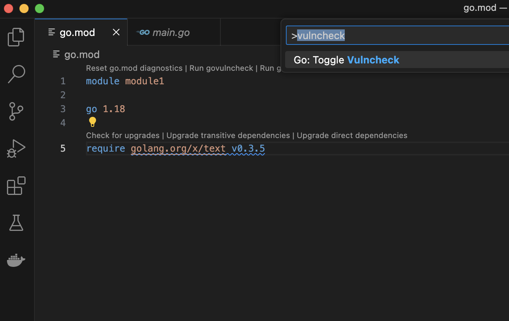
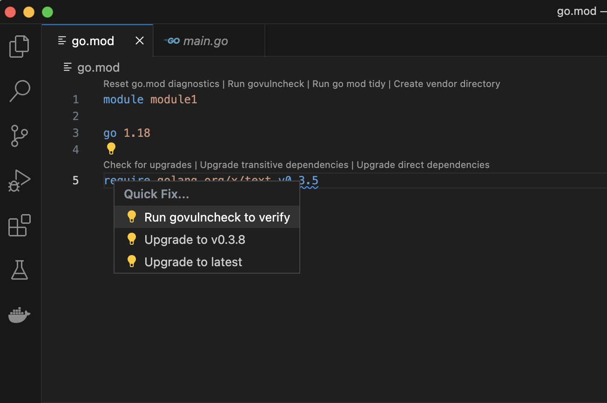
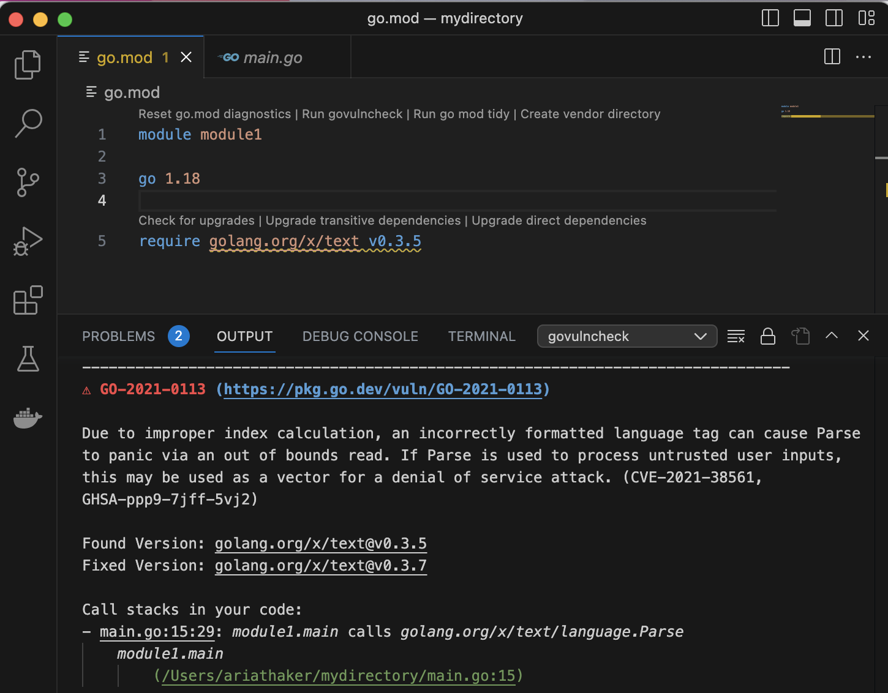
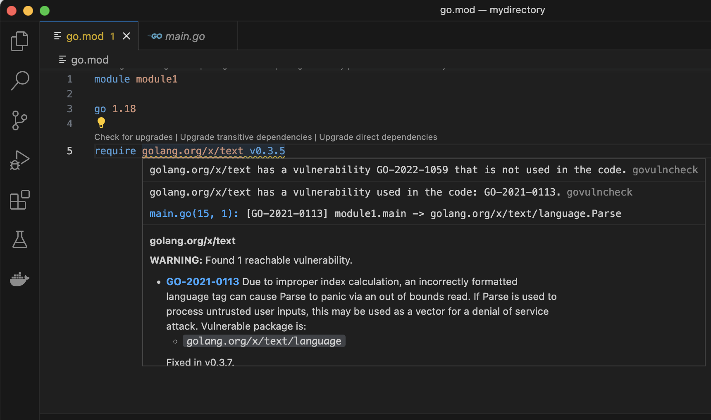
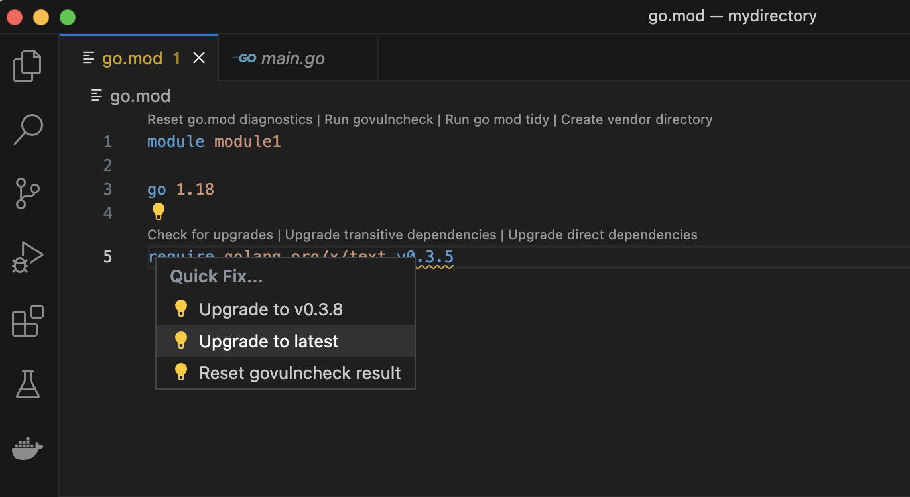

# Tutorial: Encontre e corrija dependências vulneráveis com o VS Code Go

> Tradução não oficial de [go.dev/doc/tutorial/govulncheck-ide](https://go.dev/doc/tutorial/govulncheck-ide).

[Voltar para Go Security](https://go.dev/security)

Você pode analisar o seu código em busca de vulnerabilidades direto do editor, com a extensão Go para o Visual Studio Code.

Nota: para uma explicação da correção de vulnerabilidade que aparece nas imagens abaixo, veja o [tutorial do govulncheck](govulncheck.md).

## Pré-requisitos

- **Go.** Recomendamos usar a versão mais recente do Go para seguir este tutorial. Para instruções de instalação, veja [Installing Go](https://go.dev/doc/install).
- **VS Code**, atualizado para a versão mais recente. [Baixe aqui](https://code.visualstudio.com/). Você também pode usar o Vim (veja [aqui](https://go.dev/security/vuln/editor#editor-specific-instructions) para detalhes), mas este tutorial foca no VS Code Go.
- **A extensão VS Code Go**, que pode ser [baixada aqui](https://marketplace.visualstudio.com/items?itemName=golang.go).
- **Ajustes de configuração específicos do editor.** Você vai precisar alterar as configurações da sua IDE de acordo com [estas especificações](https://go.dev/security/vuln/editor#editor-specific-instructions) antes de conseguir reproduzir os resultados abaixo.

## Como analisar vulnerabilidades usando o VS Code Go

**Passo 1.** Rode "Go: Toggle Vulncheck".

O comando [Toggle Vulncheck](https://github.com/golang/vscode-go/wiki/Commands#go-toggle-vulncheck) mostra a análise de vulnerabilidades de todas as dependências listadas nos seus modules. Para usar esse comando, abra a [command palette](https://code.visualstudio.com/docs/getstarted/userinterface#_command-palette) (paleta de comandos) da IDE (Ctrl+Shift+P no Linux/Windows ou Cmd+Shift+P no Mac OS) e rode "Go: Toggle Vulncheck". No seu arquivo `go.mod`, você vai ver os diagnósticos das dependências vulneráveis usadas direta e indiretamente no seu código.



Nota: para reproduzir este tutorial no seu editor, copie o código abaixo para o seu arquivo `main.go`.

```go
// This program takes language tags as command-line
// arguments and parses them.

package main

import (
  "fmt"
  "os"

  "golang.org/x/text/language"
)

func main() {
  for _, arg := range os.Args[1:] {
    tag, err := language.Parse(arg)
    if err != nil {
      fmt.Printf("%s: error: %v\n", arg, err)
    } else if tag == language.Und {
      fmt.Printf("%s: undefined\n", arg)
    } else {
      fmt.Printf("%s: tag %s\n", arg, tag)
    }
  }
}
```

Depois, garanta que o `go.mod` correspondente ao programa esteja assim:

```
module module1

go 1.18

require golang.org/x/text v0.3.5
```

Agora, rode `go mod tidy` para garantir que o seu arquivo `go.sum` esteja atualizado.

**Passo 2.** Rode o govulncheck por meio de uma code action.

Rodar o govulncheck por uma code action permite focar nas dependências que são realmente chamadas no seu código. No VS Code, as code actions são marcadas com ícones de lâmpada; passe o mouse sobre a dependência em questão para ver informações sobre a vulnerabilidade e depois selecione "Quick Fix" para ver um menu de opções. Entre elas, escolha "run govulncheck to verify". Isso vai mostrar a saída do govulncheck no seu terminal.





**Passo 3.** Passe o mouse sobre uma dependência listada no seu `go.mod`.

A saída do govulncheck sobre uma dependência específica também aparece quando você passa o mouse sobre ela no arquivo `go.mod`. Para uma olhada rápida nas informações de uma dependência, essa opção é ainda mais prática que usar uma code action.



**Passo 4.** Atualize para uma versão "fixed in" (corrigida) da dependência.

As code actions também podem ser usadas para atualizar rapidamente para uma versão da dependência em que a vulnerabilidade foi corrigida. Para isso, selecione a opção "Upgrade" no menu suspenso da code action.



## Recursos adicionais

- Veja [esta página](https://go.dev/security/vuln/editor) para mais informações sobre análise de vulnerabilidades na IDE. Em especial, a seção [Notes and Caveats](https://go.dev/security/vuln/editor#notes-and-caveats) discute casos especiais em que a análise pode ser mais complexa do que no exemplo acima.
- A [Go Vulnerability Database](https://pkg.go.dev/vuln/) reúne informações de várias fontes existentes, além de relatos enviados diretamente ao time de segurança do Go por mantenedores de packages Go.
- A página [Go Vulnerability Management](https://go.dev/security/vuln/) dá uma visão geral da arquitetura do Go para detectar, reportar e gerenciar vulnerabilidades.
<!-- nav -->

---

[← Primeiros passos com govulncheck](govulncheck.md) · [Índice](README.md)
